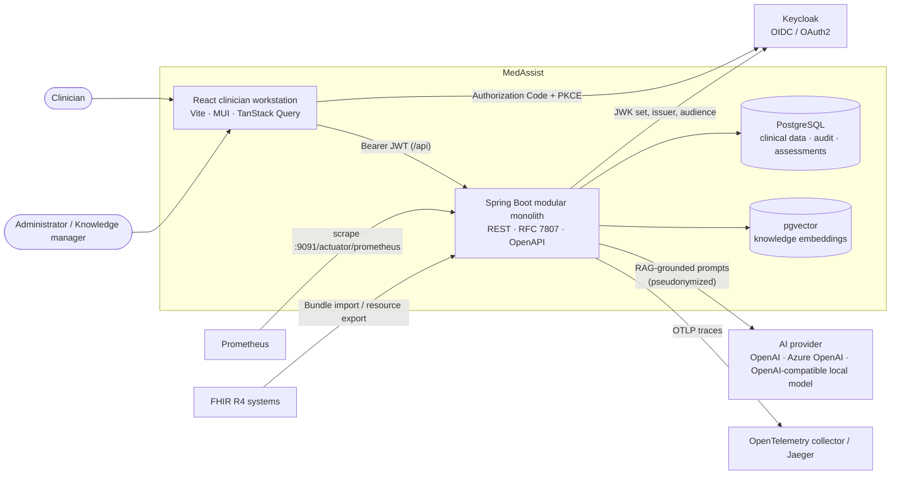
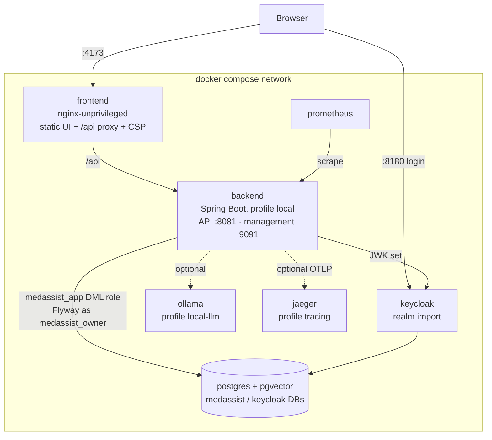
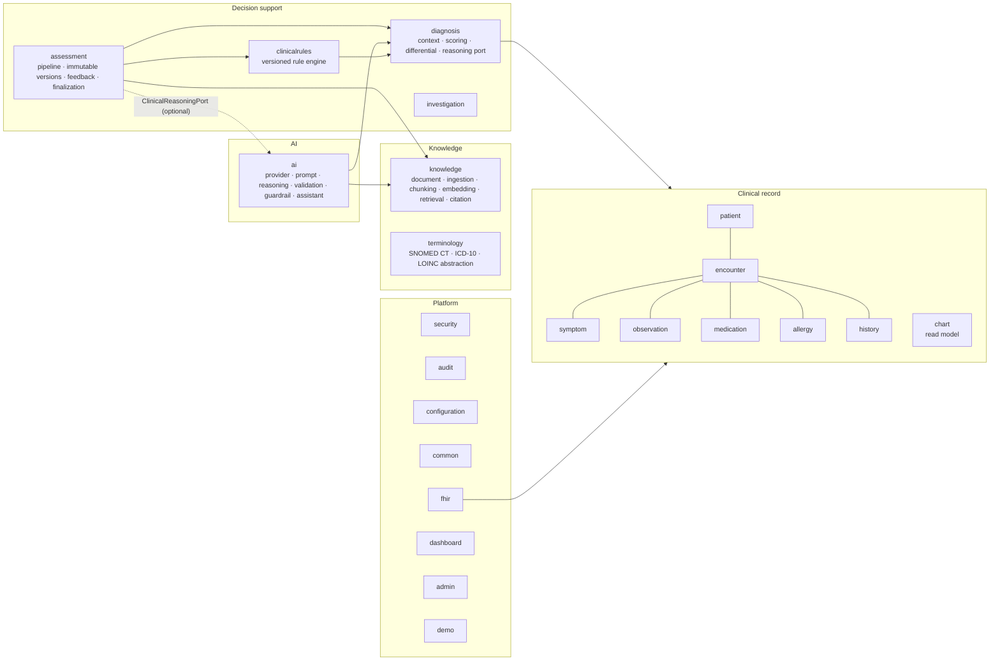
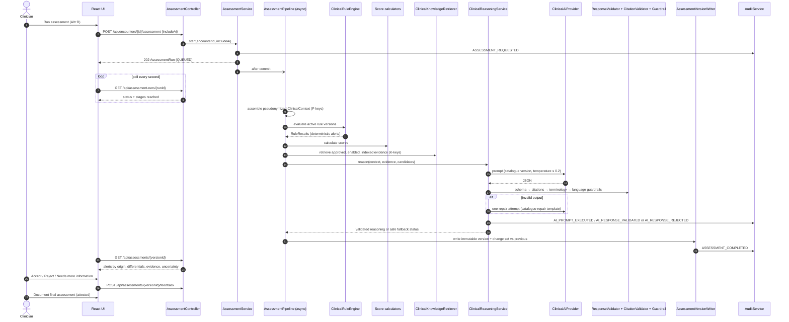
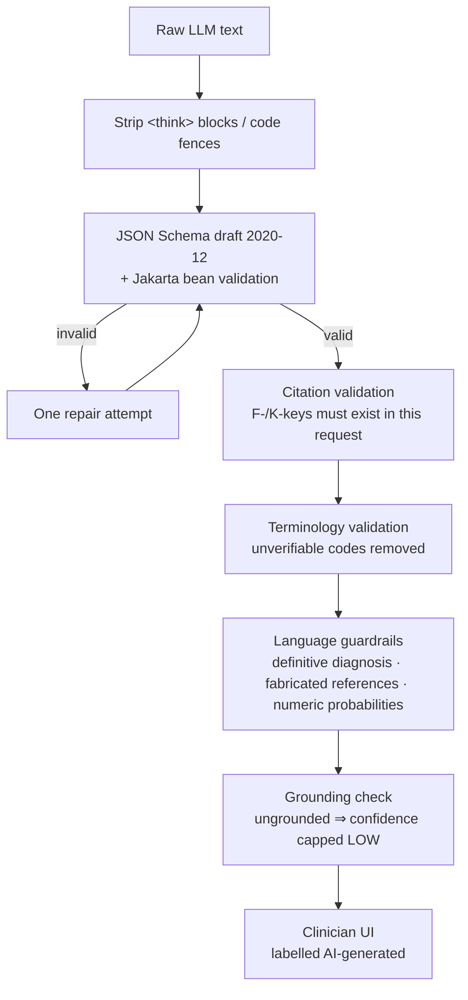
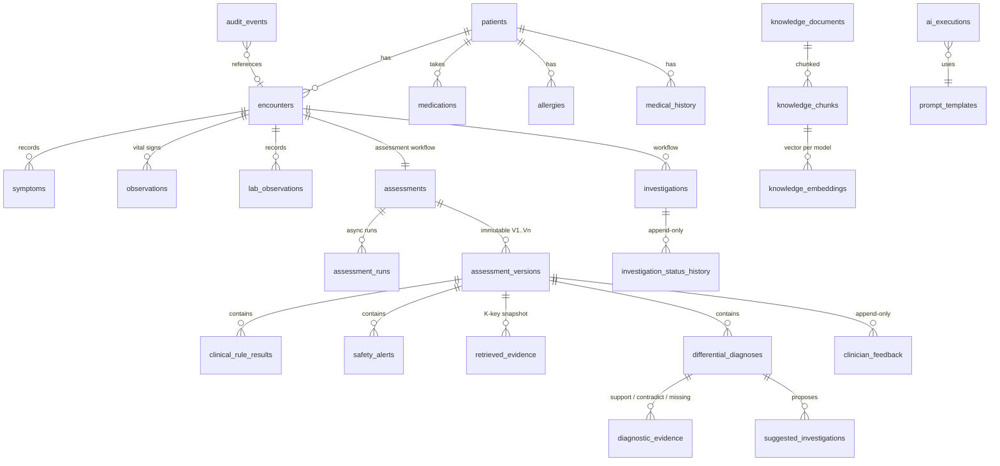

# MedAssist architecture

> MedAssist is a **clinical decision support system (CDSS)**. It never makes a diagnosis. Every AI output is
> validated deterministically, labelled by origin, and only becomes part of the record through explicit clinician
> action. All demo data is synthetic.

## 1. Guiding principles

| Principle | How it is enforced |
|---|---|
| Patient safety first | Deterministic safety rules run on every assessment and on a live endpoint that never calls AI. |
| Human in the loop | AI suggestions are `AI_GENERATED` until a clinician reviews them; the final assessment requires an explicit, attested clinician action. |
| Explainability | Every statement cites fact keys (`F1…`) and/or knowledge keys (`K1…`); the UI answers *why considered / supports / argues against / missing / distinguish / sources*. |
| Traceability | Immutable assessment versions, append-only audit trail, recorded prompt version, model, temperature and retrieved documents. |
| Deterministic validation | JSON Schema + bean validation, citation validation, terminology validation and language guardrails sit between the LLM and the UI. |
| Privacy | Pseudonymized AI context (no names, identifiers or dates of birth), least-privilege DB roles, secrets only from the environment, no PHI in logs or metric labels. |
| Graceful degradation | AI is optional. Records, rules, scores, retrieval and the workflow keep working when the provider is down or not configured. |

## 2. System context

## 3. Runtime containers (Docker Compose)

## 4. Backend module map (modular monolith)

Each module follows *controller → application service → domain → repository/adapter*. Modules reference other
aggregates by id only, and cross-module calls go through application services or ports, so modules can be extracted
later without rewriting domain code.

| Package | Responsibility |
|---|---|
| `patient`, `encounter`, `symptom`, `observation`, `medication`, `allergy`, `history` | Normalized clinical record. Every clinical value carries `RecordProvenance` (source, recorder, optional confirmer) and supports *entered in error* instead of deletion. |
| `chart` | Read model for the encounter workstation (`GET /api/encounters/{id}/chart`). |
| `diagnosis.context` | Assembles the pseudonymized `ClinicalContext` with stable fact keys `F1…Fn`; scrubs free text. |
| `diagnosis.scoring` | `ClinicalScoreCalculator` framework and one clearly-labelled demonstration calculator. |
| `diagnosis.differential` | Candidate model, confidence/grounding/support enums, deterministic ranker. |
| `clinicalrules` | `ClinicalRule` interface, `ClinicalRuleEngine`, versioned rule definitions (source, approvedBy, effective dates), demonstration rules, live safety check. |
| `assessment` | Asynchronous pipeline with real stage tracking, immutable `AssessmentVersion`s, version diffing, clinician feedback, review states, final assessment. |
| `investigation` | Suggested vs. accepted/ordered/completed investigations with status history. AI never orders. |
| `knowledge` | Document upload (PDF/TXT/Markdown/manual), extraction, cleanup, section detection, chunking, embeddings in pgvector, retrieval, citation validation. |
| `ai` | Provider abstraction (`ClinicalAiProvider`), prompt catalogue, structured-output parsing, validation, guardrails, resilience, execution records, assistant. |
| `terminology` | `ClinicalConcept(system, code, displayName)` with verification status; codes are never invented. |
| `fhir` | HAPI FHIR R4 import (Bundle) and export (Patient, Encounter, Observation, Condition, MedicationRequest, AllergyIntolerance). |
| `audit` | Append-only `AuditEvent` with correlation id; sanitizes metadata. |
| `security` | OAuth2 resource server, Keycloak role mapping, method-level authorization, user directory. |

## 5. Clinical assessment pipeline

The pipeline runs asynchronously (virtual threads) after the request transaction commits. Each stage is persisted in
its own transaction so the UI can show **real** progress (no synthetic percentages).

```mermaid
flowchart LR
    A[Clinical information] --> B[Validation &<br/>data-quality warnings]
    B --> C[Terminology<br/>normalization]
    C --> D[Deterministic<br/>safety rules]
    D --> E[Clinical scores]
    E --> F[Knowledge retrieval<br/>pgvector]
    F --> G[Differential<br/>candidate generation]
    G --> H[LLM reasoning<br/>optional]
    H --> I[Structured output<br/>validation]
    I --> J[Citation<br/>validation]
    J --> K[Safety validation<br/>guardrails · codes]
    K --> L[Ranking]
    L --> M[(Immutable<br/>assessment version)]
    M --> N[Clinician UI]
    D -. "rules never depend on AI" .-> M
```

### Assessment sequence

### What happens when AI is unavailable

| Situation | Result |
|---|---|
| `AI_PROVIDER=none` or misconfigured | `DisabledClinicalAiProvider`; status `NOT_CONFIGURED`. Rules, scores, retrieval and knowledge-linked candidates still produced. |
| Timeout / provider error / circuit open | Status `UNAVAILABLE`, audited as `AI_PROVIDER_FAILURE`; non-alarming UI message; safe retry by re-running. |
| Output fails schema/validation twice | Status `OUTPUT_REJECTED`; malformed output never reaches the UI; audited as `AI_RESPONSE_REJECTED`. |

## 6. AI safety layers

1. **Structured output** — prompts demand JSON matching `ai/schemas/clinical-reasoning-output.v1.schema.json`.
2. **RAG grounding** — only passages from approved, enabled, indexed documents are provided as `K` keys.
3. **Restricted system prompts** — centrally managed, versioned, checksummed (`prompts/catalog.json`), immutable per version in the database.
4. **Deterministic validation** — schema, bean validation and domain rules.
5. **Citation validation** — citations must reference evidence actually supplied in that request; invalid citations are removed and uncited statements are marked `UNSUPPORTED`.
6. **Terminology validation** — SNOMED CT / ICD-10 / LOINC codes that cannot be verified are dropped; concepts are shown as unverified.
7. **Clinician confirmation** — review states `AI_GENERATED → REVIEWED/ACCEPTED/REJECTED/MODIFIED → FINALIZED`.
8. **Audit trail** — prompt id/version, model, temperature, retrieved documents, validation outcome.

Hidden chain-of-thought is never requested or displayed; the model returns concise, clinician-facing summaries.

## 7. Data model (key tables)

* Migrations: `backend/src/main/resources/db/migration` (`V1`–`V9` plus repeatable grants `R__application_role_grants.sql`).
* Append-only tables are protected by database triggers (`medassist_reject_modification`) **and** revoked privileges for the runtime role.
* Rule definitions and prompt templates are immutable per version; changes create a new version.
* Embeddings live in an unconstrained `vector` column keyed by `(chunk_id, embedding_model)` so models can be switched without migrations; retrieval filters by model id and dimensions. For large corpora add an HNSW index per model/dimension (`CREATE INDEX ... USING hnsw ((embedding::vector(1536)) vector_cosine_ops) WHERE embedding_model = '...'`).

## 8. Knowledge ingestion

```mermaid
flowchart LR
    up[Upload PDF / TXT / MD<br/>or manual entry] --> chk[Checksum · size/type validation]
    chk --> ext[Text extraction<br/>PDFBox per page]
    ext --> clean[Cleanup<br/>hyphenation, whitespace, headers]
    clean --> sec[Section detection]
    sec --> chunk[Chunking<br/>max chars · overlap · min chars]
    chunk --> meta[Metadata enrichment<br/>document, version, section, page, index]
    meta --> emb[Embeddings<br/>configurable provider]
    emb --> pgv[(pgvector)]
    pgv --> ret[Retriever: approved + enabled + indexed<br/>min similarity · max chunks per document]
```

Similarity scores are shown only as "retrieval similarity" and are never presented as clinical confidence.

## 9. Security architecture

* **Authentication**: OIDC Authorization Code + PKCE (public SPA client). Tokens are held in session storage and sent as bearer tokens; the backend is a stateless resource server validating signature (JWK set), expiry, issuer and audience (`medassist-api`).
* **Authorization**: Keycloak realm roles → `ROLE_CLINICIAN`, `ROLE_ADMIN`, `ROLE_KNOWLEDGE_MANAGER`; URL rules plus method-level `@RequireClinician`, `@RequireAdmin`, `@RequireKnowledgeAccess`. Administrators cannot read patient records; clinicians cannot change rules or knowledge.
* **Account control**: an application-side user directory can disable a user immediately (checked on every request).
* **Transport/headers**: CSP, `X-Frame-Options: DENY`, `nosniff`, `Referrer-Policy: no-referrer`; HSTS in production; CORS allow-list from configuration.
* **Database**: separate owner (DDL/migrations) and runtime (DML only) roles; append-only tables cannot be updated or deleted by the runtime role.
* **Secrets**: environment variables only; `.env` is generated locally and git-ignored; API keys are never returned by the API.
* **Logging**: structured (ECS) logs with correlation and trace ids; audit metadata is sanitized; patient names never appear in logs or metric labels.

## 10. Observability

| Signal | Implementation |
|---|---|
| Correlation | `X-Correlation-Id` header (generated if absent), MDC, returned in RFC 7807 problems. |
| Metrics | Micrometer → Prometheus on management port 9091: `assessment_duration`, `rag_query_duration`, `llm_duration`, `llm_failures`, `llm_validation_failures`, `clinical_rule_execution_duration`, `knowledge_ingestion_duration` (+ JVM/HTTP/Hikari). |
| Tracing | Micrometer Tracing → OpenTelemetry OTLP (enable with `TRACING_EXPORT_ENABLED=true`; Jaeger via `--profile tracing`). |
| Health | `/actuator/health/{liveness,readiness}`; admin "System health" screen aggregates database, AI provider, embeddings and knowledge base status. |

## 11. Frontend architecture

* `src/api` — typed fetch client (RFC 7807 errors → `ApiError`), DTO types, TanStack Query hooks.
* `src/auth` — `react-oidc-context` provider, `AuthGate`, role guards; safe post-login redirect handling.
* `src/features/encounter` — the three-column workstation: clinical data (left), safety alerts / assessment / differentials (centre), explainability / knowledge / assistant (right), sharing a `WorkstationContext`.
* `src/features/admin` — code-split administration screens (knowledge base, rules, AI configuration, audit, users, health).
* Visual language: deterministic alerts use solid severity bars and origin labels (RULE, CLINICAL SCORE); AI content uses a dashed violet frame, an AI icon and "AI-generated" labels so it can never be mistaken for a rule warning.
* Runtime configuration (`/runtime-config.js`) is generated from environment variables at container start; one image serves every environment.

See [ADRs](adr/) for the reasoning behind the main decisions.
